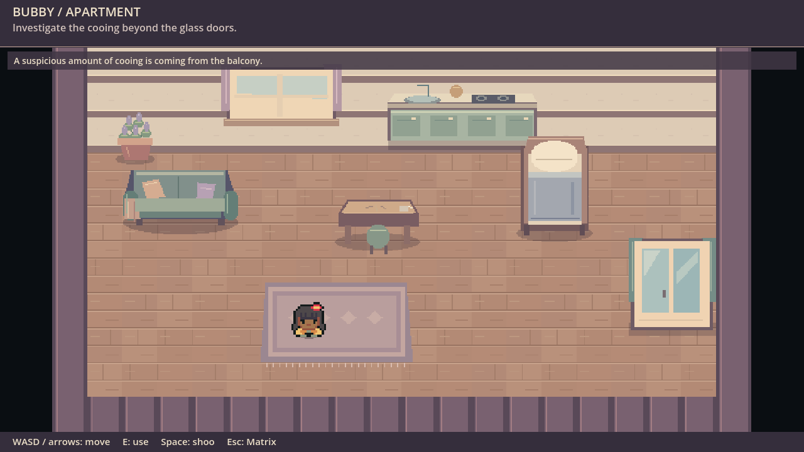
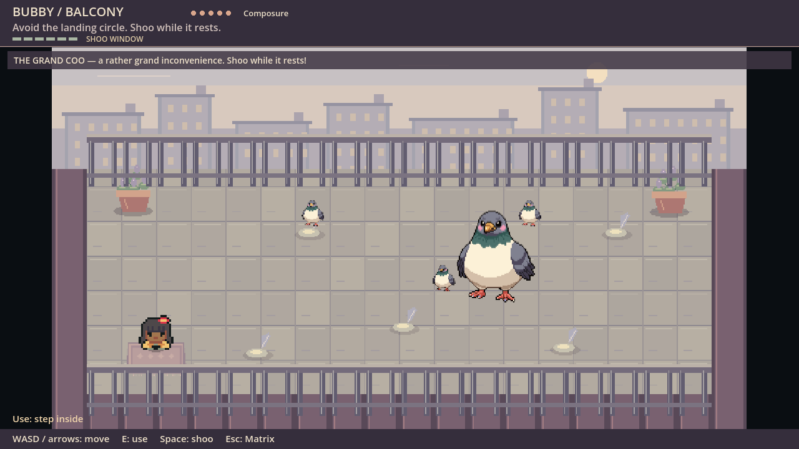
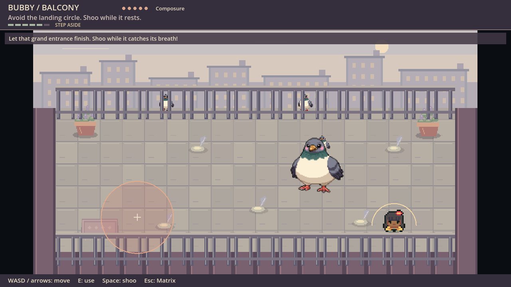
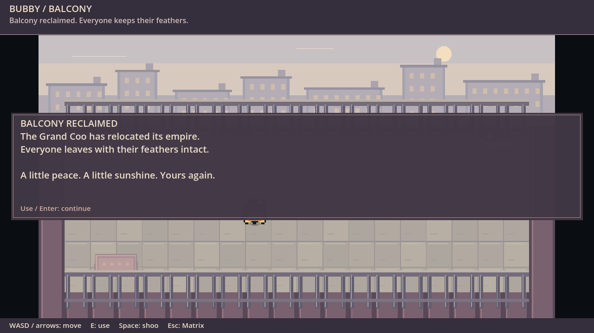
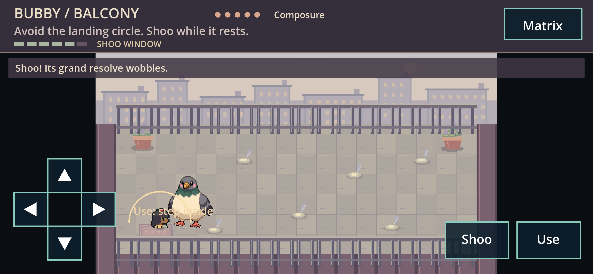

# Bubby creative review

Actual Godot 4.7.2 Compatibility renders; no concept mockups. Desktop captures
come from positioned/accelerated validation fixtures (1280×720). Phone capture
comes from real browser touch navigation/combat in a landscape Chrome context
(844×390 CSS pixels, DPR 3), not a physical iPhone. Scenes are independently
editable; apartment, balcony architecture and protagonist likeness are provisional.

The main artistic improvement is the pigeon silhouette/feather treatment and
coherent softer environment palette. Furniture is still simpler than the boss;
architecture is generic and lacks authentic personal details. The avatar is
retained tutorial art, not Kate's likeness. Bird flight uses transforms rather
than bespoke flapping animation. No human art/balance/physical-device acceptance
is claimed. [Gameplay and controls](../../../levels/bubby/README.md).
