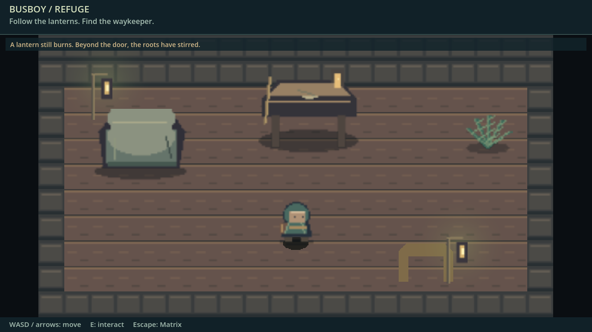
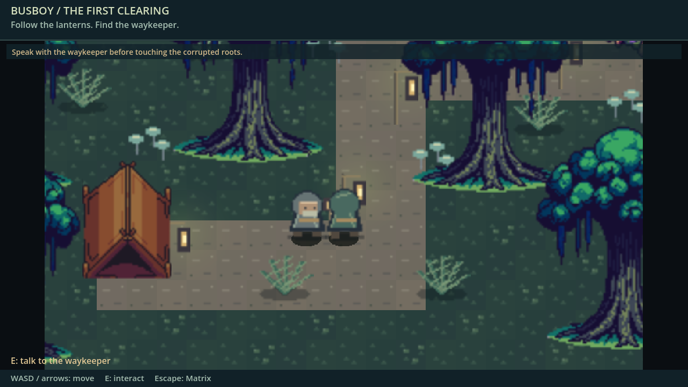
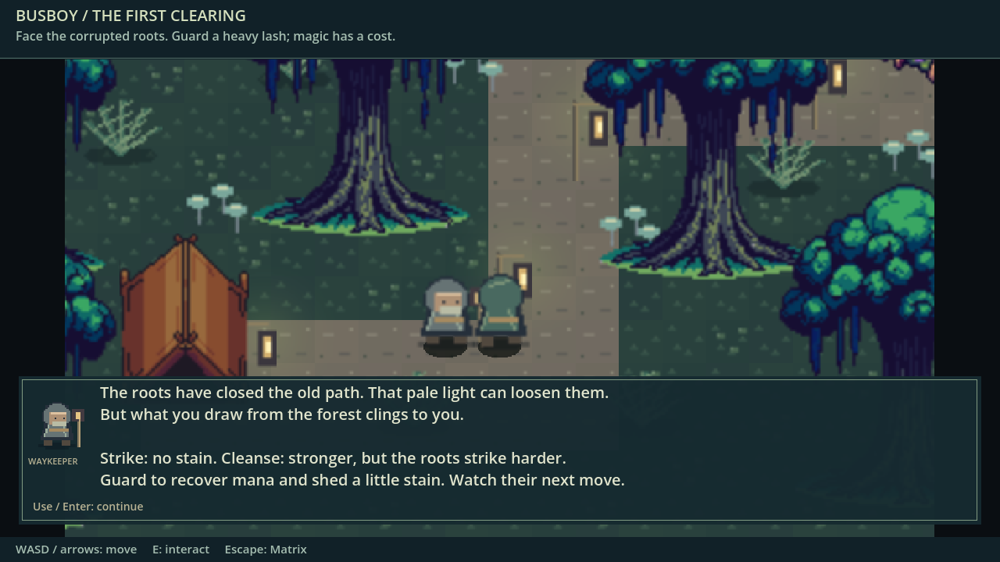
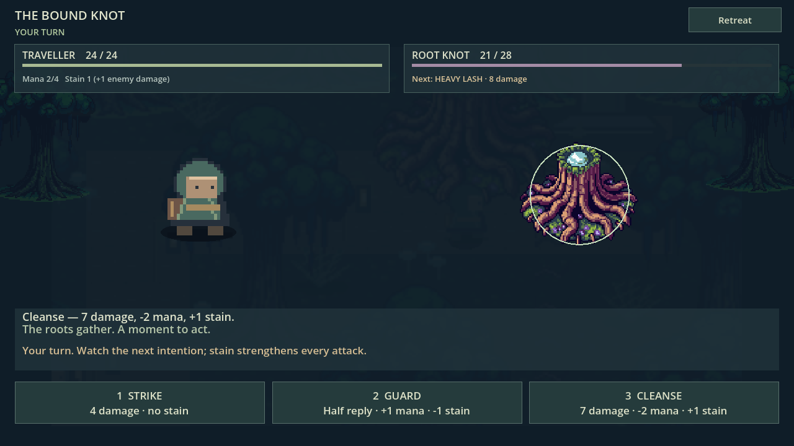
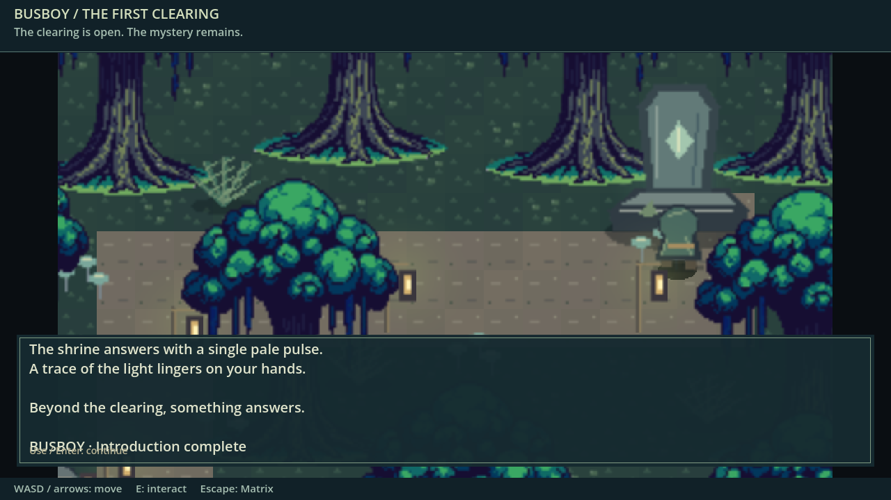
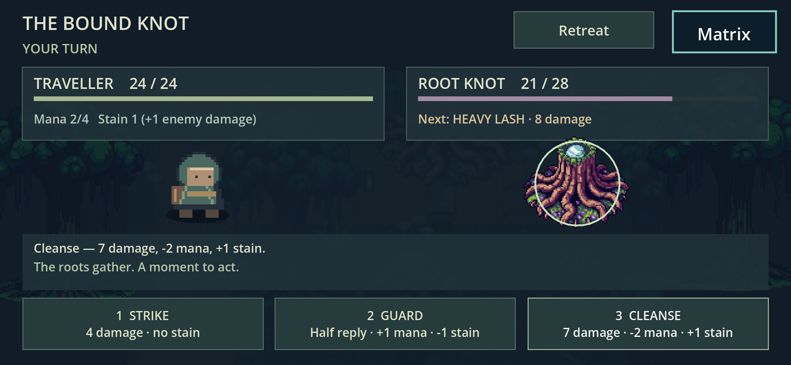

# Busboy creative review

Actual Godot 4.7.2 Compatibility frames, not concept mockups. Desktop scenes use
positioned/accelerated complete-introduction validation at 1280×720. The phone
capture is an 844×390 CSS / DPR3 browser context using actual canvas touch
navigation and battle buttons, not a physical iPhone.

The strongest gains are the canopy/root silhouettes, coherent cool woodland
palette, readable trail, grounded characters and combat hierarchy. Remaining
limits: repeated tree silhouettes/litter, simpler character/cabin geometry,
static generated props and unapproved writing/style. No reliably attributable
Kobe originals were found; no final artistic approval or legal clearance is
implied. [Implementation, tests and next inputs](../../../levels/busboy/README.md).
