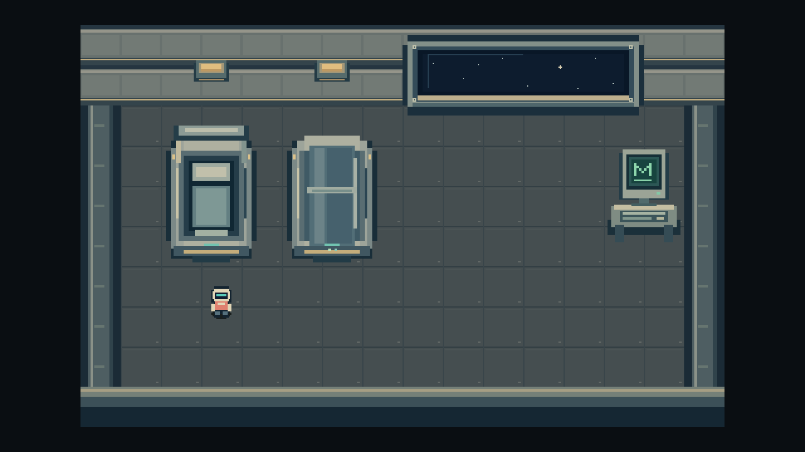
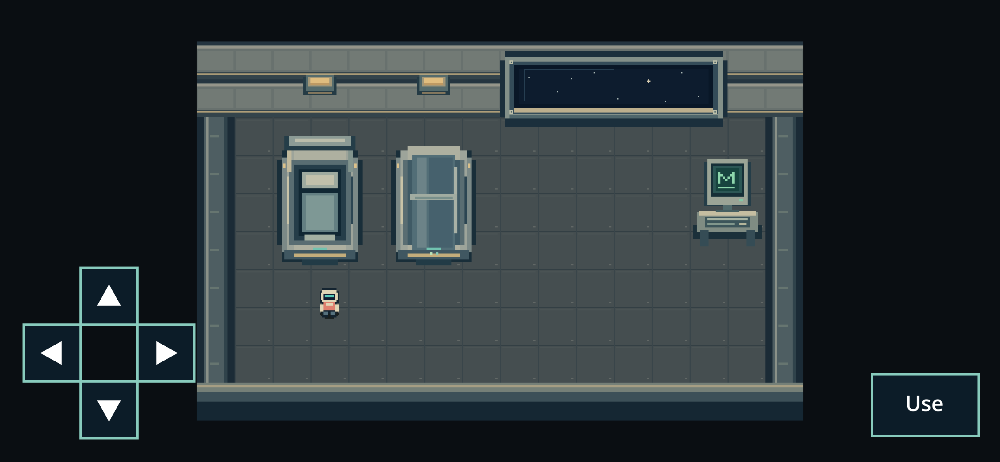
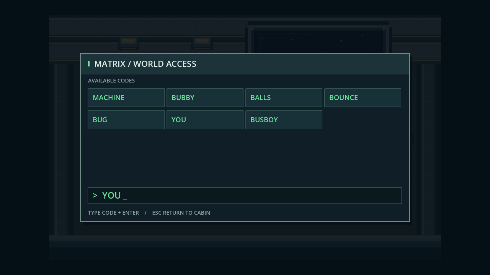
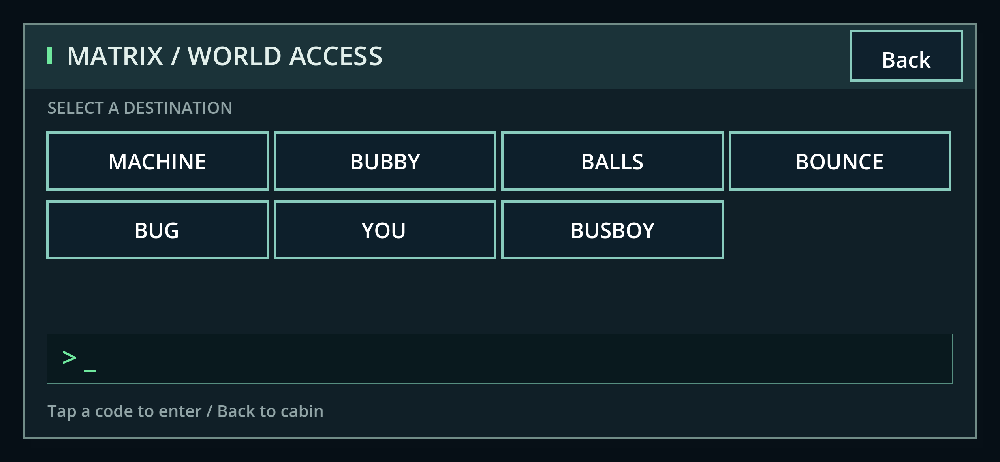

# Hub refinement review captures

These are round-1 captures. [Round 2](../hub-round2/README.md) supersedes the
room artwork and removes the terminal directory shown below.

Captured from the implementation in `371696c`, using Godot 4.7.2 Compatibility.
These are actual rendered frames, not concept art.

| Native desktop (1280×720) | Landscape Chrome touch emulation (844×390 CSS, DPR 3) |
| --- | --- |
|  |  |
|  |  |

The native captures use `scripts/validation/hub_check.gd -- --capture DIR`.
Browser captures come from Playwright's real canvas movement/code/return checks.
Touch emulation does not certify physical iPhone behavior or human movement feel.

Editable art: `art/hub/refinement/`; native room: `hub/world.tscn`. No PixelLab
generation was used. Full status: `docs/releases/alpha-0.2-hub-refinement.md`.
