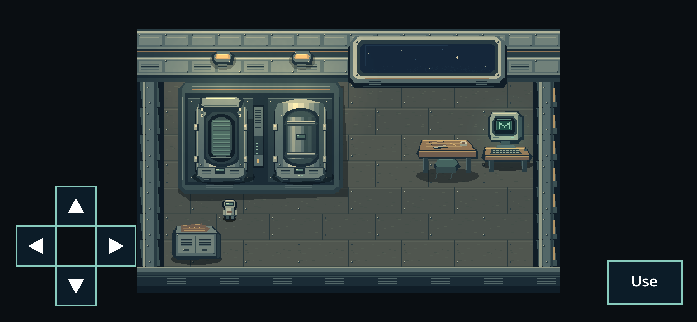
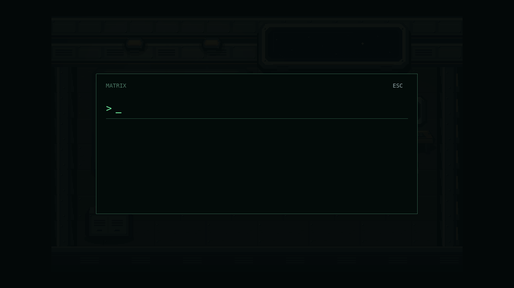
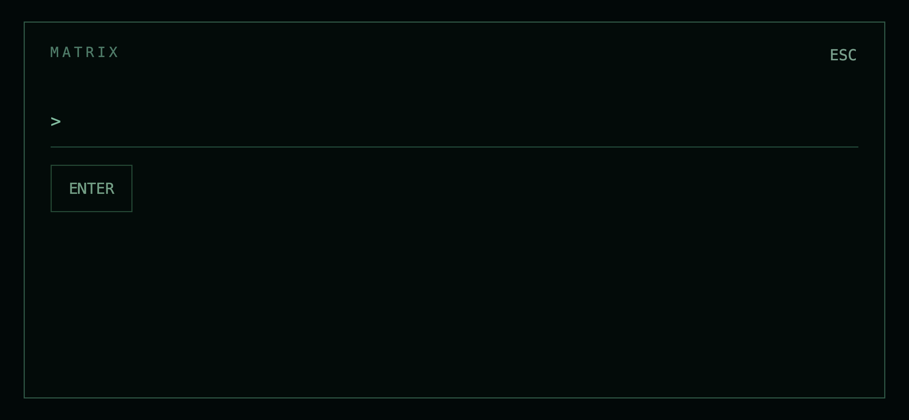
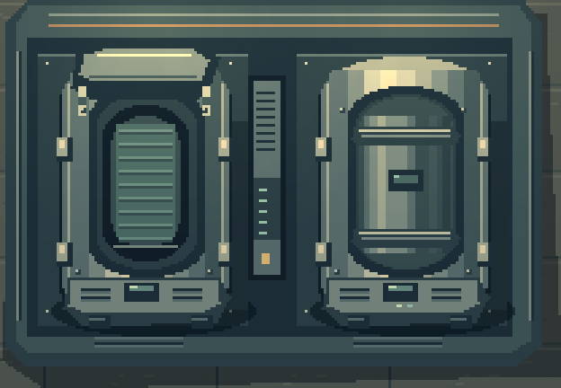
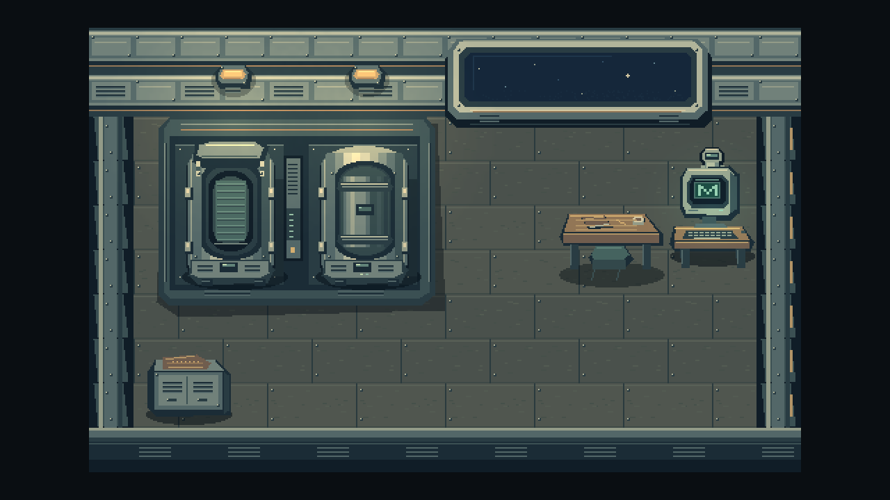

# Hub refinement — round 2 review

Actual local working-tree frames from Godot 4.7.2 Compatibility and Chrome,
not concept art. Implementation: `c1aa0b6`, PR #17. These assets were authored
as original layered raster studies; **no PixelLab or AI image generation used**.

| Native desktop, 1280×720 | Landscape Chrome touch emulation, 844×390 CSS / DPR 3 |
| --- | --- |
|  |  |
|  |  |

The field is empty when opened. It contains no list of codes/destinations or
world/simulation explanation. Phone users tap the actual text field to request
their OS keyboard; ENTER/Go submits, ESC closes. Browser emulation does not
render or certify the physical iPhone keyboard.

Left: raised lid and a continuous ribbed **empty** mattress. Right: opaque cover
and status instruments; no visible inhabitant or identity. The close-up is a
reframed native Godot render, including scene lighting, rather than an enlarged
source image.

Props use floor-level anchors and native y-sorting: this synthetic legal
position behind the computer demonstrates occlusion. It is a rendering check,
not a claim of human gameplay acceptance.

The browser captures use the same final artwork/UI, taken just before the
presentation-only floor-anchor adjustment; native captures include that change.
Latest exact-commit browser evidence is also retained in PR #17's CI artifacts.

The room is richer and more cohesive, but still a code-authored illustrated
draft. Perspective, repetitive architectural modules, texture and the small
avatar remain candidates for a human art pass. The earlier owner reference
image was unavailable. See the [A–E pipeline assessment](../../releases/alpha-0.2-hub-round2.md).

Sources: `art/hub/round2/`; native room: `hub/world.tscn`. The [first-round
captures](../hub-refinement/README.md) are retained for comparison.
